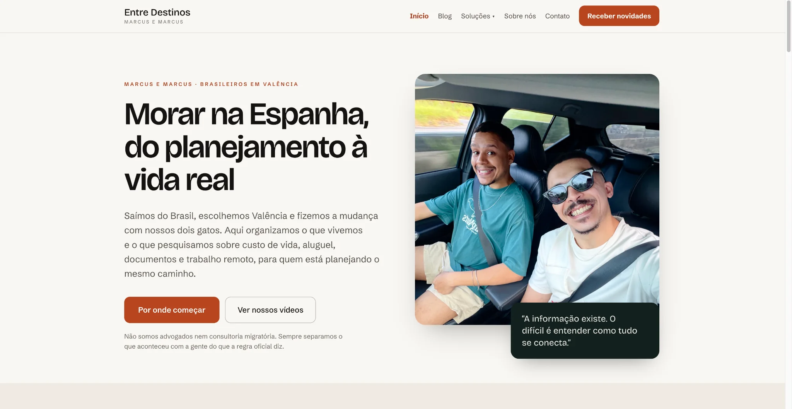
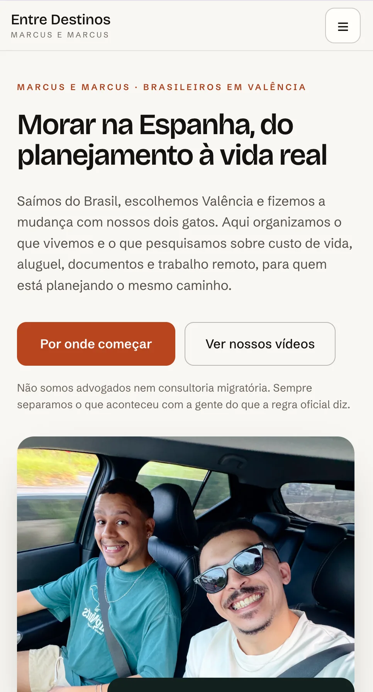
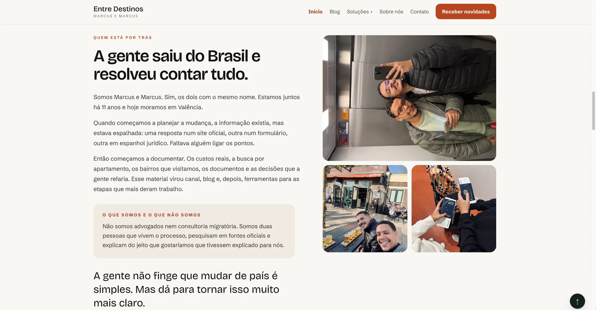
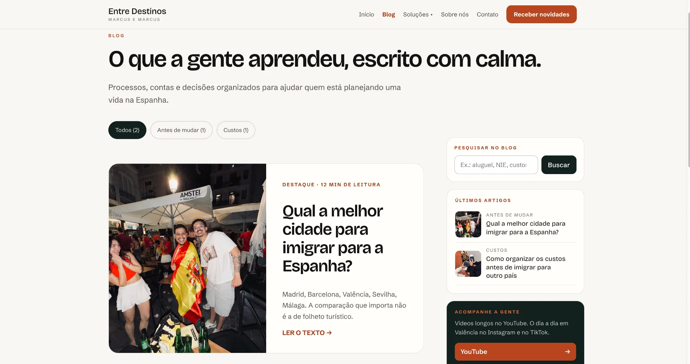
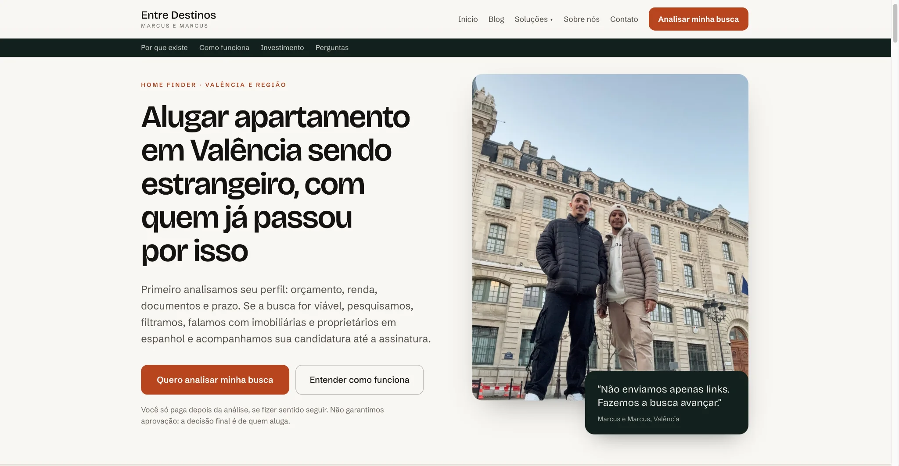
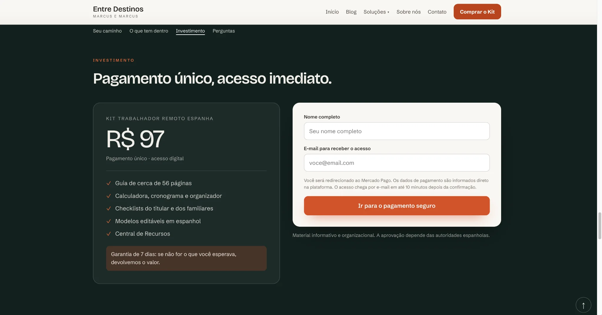
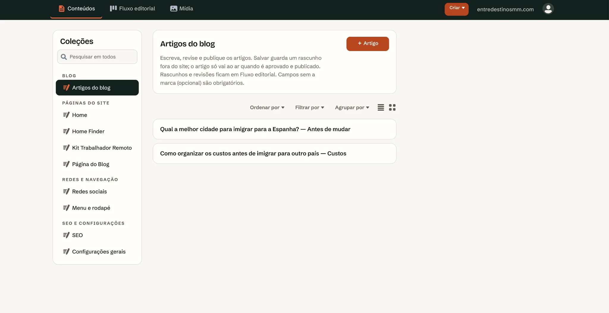
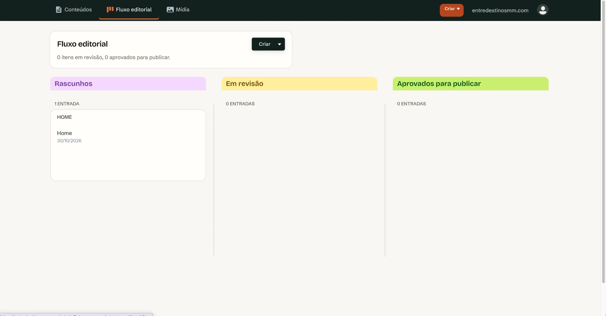
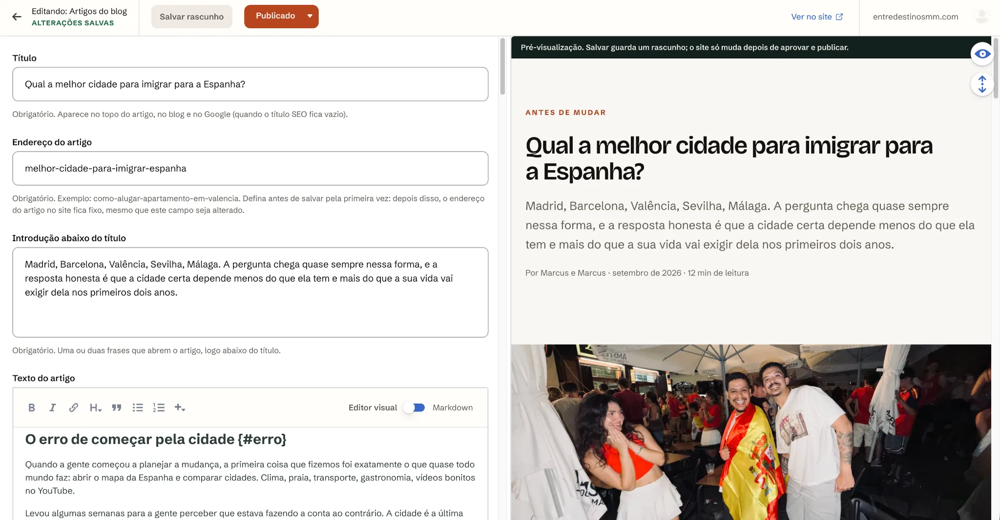

<div align="center">

[🇺🇸 English](./README.md) · [🇧🇷 Português](./README.pt-BR.md) · **🇪🇸 Español**

# Entre Destinos

### Contenidos, servicios para viajeros y comercio digital en una misma plataforma

**Un caso de producto e ingeniería de Marcus Castro.**

[Sitio web](https://entredestinosmm.com/) · [Arquitectura](docs/architecture.md) · [Funciones](docs/features.md)

</div>

> **Portafolio público.** El código de producción, las credenciales, los datos de clientes, los productos digitales de pago y la configuración operativa permanecen privados.

## El proyecto

Entre Destinos es una plataforma que combina publicación editorial, captación de contactos, servicios para quienes planean mudarse de país, venta de productos digitales y entrega automatizada.

Integra un blog por categorías, el servicio Home Finder, un kit para trabajadores remotos, suscripción a novedades, contenidos optimizados para buscadores y un panel editorial privado.

## Qué desarrollé

### Generación estática

Scripts de Node.js combinan plantillas de páginas y contenido JSON estructurado para generar el sitio. Los archivos publicados permanecen separados del código y los contenidos de origen.

### Flujo editorial

Decap CMS ofrece un panel de publicación por invitación para páginas, navegación, artículos, SEO e imágenes, con revisión antes de publicar en producción.

### Arquitectura de contenidos y SEO

Generación de URLs canónicas, artículos, categorías, redirecciones, migas de pan, sitemap, metadatos y datos estructurados apropiados según el tipo de página.

### Comercio y entrega digital

Checkout de Mercado Pago integrado mediante funciones serverless y entrega gestionada con webhooks. Las credenciales y los productos de pago no se incluyen en este repositorio.

### Pruebas y privacidad

Pruebas automatizadas de publicación, enlaces, imágenes, datos estructurados, vistas previas y funciones serverless. El procesamiento de imágenes elimina metadatos incrustados, incluidos datos EXIF de localización.

## Tecnologías

| Área | Tecnologías |
| --- | --- |
| Construcción | Node.js · JavaScript · generación estática personalizada |
| Contenido | JSON · Markdown · Decap CMS |
| Infraestructura | Netlify · funciones serverless · Git |
| Comercio | Mercado Pago · webhooks |
| Calidad | Node test runner · validaciones de contenido y build |
| Frontend | HTML semántico · CSS · JavaScript · diseño responsivo |

## Arquitectura

```text
Editores → Decap CMS → Contenido estructurado
                        ↓
            Build y validaciones Node.js
                        ↓
     Páginas, metadatos, sitemap y redirecciones
                        ↓
                    Netlify
           Sitio público + funciones serverless
```

## Galería del producto

### Sitio web y diseño responsivo

**Portada en escritorio.** Storytelling, navegación, llamadas a la acción y diseño modular.



**Portada móvil.** Jerarquía de contenidos adaptada a pantallas pequeñas.



**Sobre nosotros.** Historia e identidad editorial del proyecto.



### Contenidos y conversión

**Blog.** Categorías, búsqueda y artículos destacados.



**Home Finder.** Página de servicio orientada a solicitudes de evaluación.



**Kit para trabajadores remotos.** Presentación comercial y recorrido hacia el pago.



### Gestión editorial

**Colecciones.** Páginas, artículos, navegación y SEO.



**Flujo editorial.** Borradores, revisión y aprobación.



**Editor de artículos.** Edición de contenido y vista previa en paralelo.



Las imágenes documentan las interfaces; el acceso al panel y las credenciales siguen siendo privados.

## Mi papel

Arquitectura de información, frontend, diseño responsivo, modelado de contenido, integración de checkout y webhooks, fundamentos SEO, pruebas, documentación y publicación.

## Límites del repositorio

No se distribuyen código de producción, secretos, información de clientes o suscriptores, productos de pago ni configuración privada del CMS o de la infraestructura.

---

**Desarrollado y documentado por [Marcus Castro](https://github.com/marcuscastrodev)** · Desarrollo web, producto y estrategia digital
