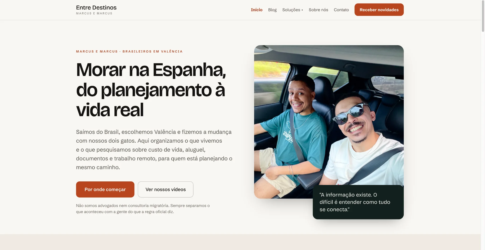
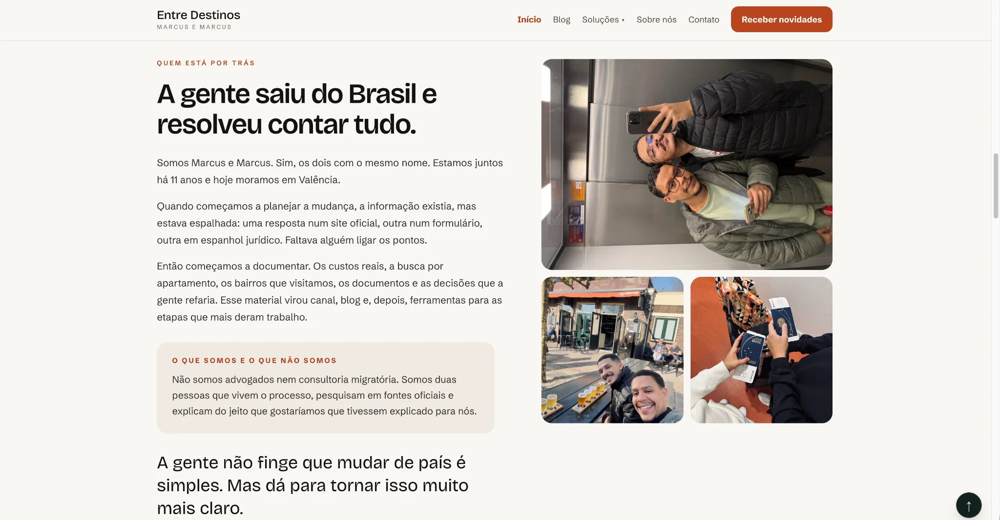
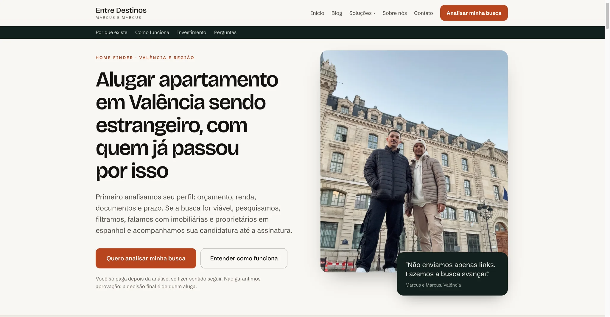
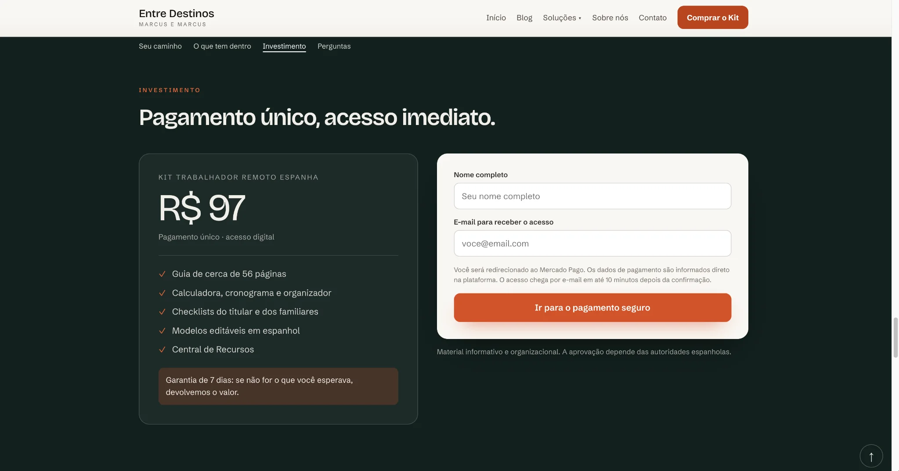
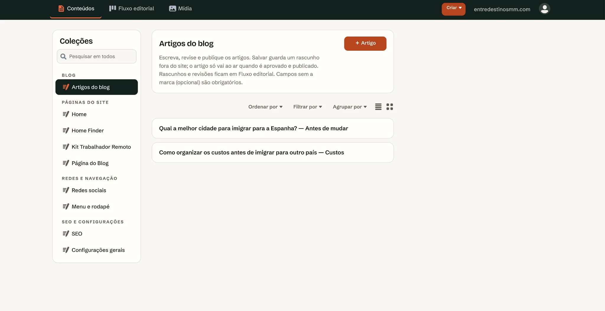
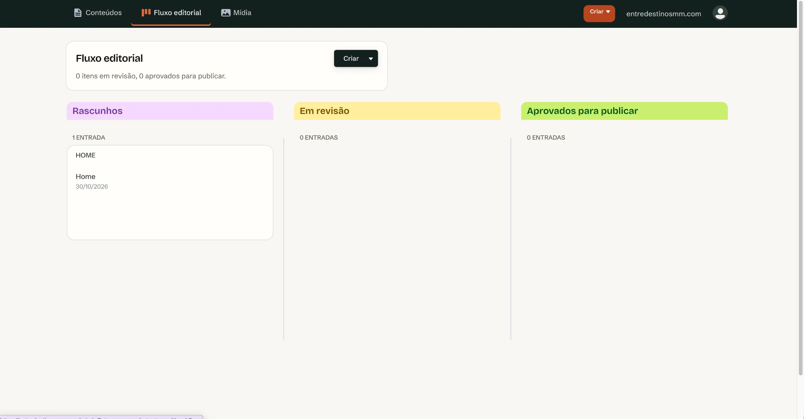
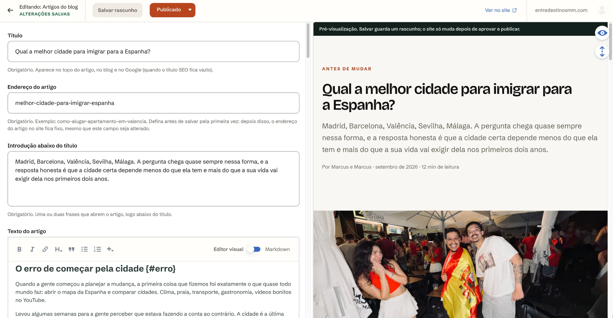

<div align="center">

[🇺🇸 English](./README.md) · **🇧🇷 Português**

# Entre Destinos

### Conteúdo, serviços para viajantes e comércio digital em uma mesma plataforma

**Um estudo de produto e engenharia por Marcus Castro.**

[Site publicado](https://entredestinosmm.com/) · [Arquitetura](docs/architecture.md) · [Recursos do produto](docs/features.md)

</div>

> **Vitrine pública de portfólio.** O código de produção, as credenciais, as informações de clientes, os produtos digitais pagos e a configuração operacional permanecem privados. Este repositório documenta o produto, a arquitetura e o trabalho de engenharia sem expor ativos sensíveis.

## O projeto

Entre Destinos é uma plataforma de conteúdo e serviços para viajantes que reúne publicação editorial, geração de leads, checkout e entrega digital. O site público é gerado a partir de conteúdo estruturado e publicado por meio de um fluxo editorial controlado.

O produto conecta diferentes jornadas:

- Artigos de viagem organizados por categoria
- Serviço Home Finder para quem planeja uma mudança internacional
- Kit digital para trabalhadores remotos
- Newsletter e páginas orientadas à conversão
- Arquitetura de conteúdo preparada para busca
- Painel editorial privado para publicação sem edição de código

## O que desenvolvi

### Sistema de publicação estática

Scripts em Node.js combinam modelos de página com conteúdo estruturado em JSON e geram o site que será publicado. A saída gerada fica separada dos arquivos de origem.

### Fluxo editorial

O Decap CMS oferece uma interface por convite para editar páginas, navegação, SEO, mídia e artigos. As alterações seguem um fluxo de revisão antes de chegar à branch de produção.

### Busca e arquitetura de conteúdo

O build cria URLs canônicas, páginas de artigos e categorias, redirecionamentos de formatos antigos, breadcrumbs, sitemap, diretivas de rastreamento, metadados e dados estruturados adequados a cada tipo de página.

### Comércio e entrega digital

A plataforma integra o checkout do Mercado Pago a funções serverless e entrega orientada por webhook. Credenciais e o produto digital pago não fazem parte desta vitrine.

### Verificação e privacidade

Testes automatizados cobrem publicação, links internos, imagens, dados estruturados, geração de páginas, prévias editoriais e fluxos serverless. O processamento de imagens remove metadados incorporados, incluindo campos EXIF relacionados à localização.

## Destaques de engenharia

- Conteúdo estruturado separado dos modelos visuais
- Geração estática para entrega previsível e eficiente
- Prévias editoriais e publicação com revisão
- Automação de blog, categorias, breadcrumbs, canônicos, redirecionamentos e sitemap
- Dados estruturados Schema.org derivados do conteúdo visível
- Checkout serverless e processamento de webhooks
- Fallback controlado para feeds externos
- Validação automatizada de conteúdo, SEO, mídia e publicação
- Processamento de imagens orientado à privacidade

## Tecnologias

| Área | Tecnologias |
| --- | --- |
| Build | Node.js, JavaScript, geração estática personalizada |
| Conteúdo | JSON, Markdown, Decap CMS |
| Hospedagem | Netlify, funções serverless, deploy baseado em Git |
| Comércio | Checkout e webhooks do Mercado Pago |
| Qualidade | Node test runner, validações automatizadas de conteúdo e build |
| Frontend | HTML semântico, CSS, JavaScript, layouts responsivos |

## Arquitetura resumida

```text
Editores
   |
   v
Decap CMS + fluxo de revisão no Git
   |
   v
Conteúdo estruturado de páginas e artigos
   |
   v
Build e validações em Node.js
   |
   +----> Páginas, metadados, sitemap e redirecionamentos
   |
   v
Publicação na Netlify
   |
   +----> Site público
   +----> Checkout e webhooks serverless
```

Consulte as [notas de arquitetura](docs/architecture.md) para entender os principais limites e decisões.

## Minha atuação

O projeto demonstra trabalho em:

- Produto e arquitetura da informação
- Implementação frontend e comportamento responsivo
- Modelagem de conteúdo e desenho do fluxo editorial
- Geração estática e automação de build
- Fundamentos de SEO e dados estruturados
- Integração de checkout e webhooks
- Testes, investigação de problemas, documentação e publicação

## Galeria do produto

### Site público e experiência responsiva

**Página inicial — desktop.** Storytelling editorial, navegação clara, chamadas para ação e estrutura modular.



**Página inicial — mobile.** A hierarquia de informações adaptada à tela do celular, com navegação responsiva.


**Sobre nós.** Página editorial que conecta a história do projeto às necessidades do público.



### Conteúdo e jornadas de conversão

**Blog.** Descoberta de artigos com categorias, busca, conteúdo em destaque e barra lateral complementar.


**Home Finder.** Landing page que apresenta o serviço e conduz à solicitação de análise.



**Kit Trabalhador Remoto.** Interface comercial com detalhes da oferta, campos de identificação e encaminhamento ao pagamento.



### Gerenciamento editorial

**Coleções de conteúdo.** O CMS privado organiza artigos, páginas editáveis, navegação e configurações de SEO.



**Fluxo editorial.** Etapas de rascunho, revisão e aprovação que estruturam a publicação.



**Editor com pré-visualização.** Campos de edição e visualização do artigo lado a lado.



As capturas documentam apenas as interfaces. O acesso ao CMS, as permissões, as credenciais e o código operacional permanecem privados.

## Limites desta vitrine

Este repositório não distribui:

- Código da aplicação de produção
- Valores de ambiente, tokens ou identificadores de contas
- Informações de clientes ou assinantes
- O produto digital pago
- Configurações privadas de CMS ou infraestrutura

O site publicado e seu conteúdo são a experiência pública oficial do produto.

---

**Desenvolvido e documentado por [Marcus Castro](https://github.com/marcuscastrodev)** · Desenvolvimento web, visão de produto e estratégia digital
